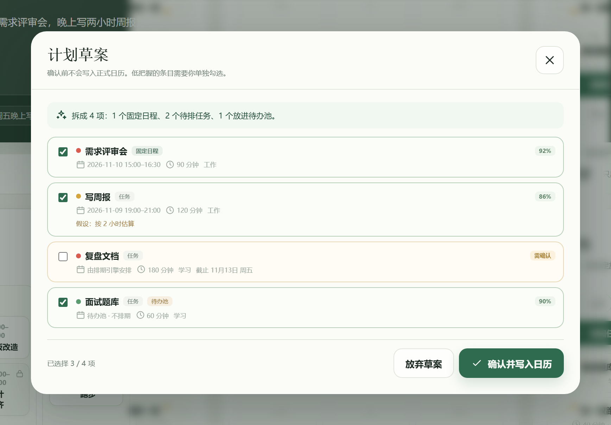
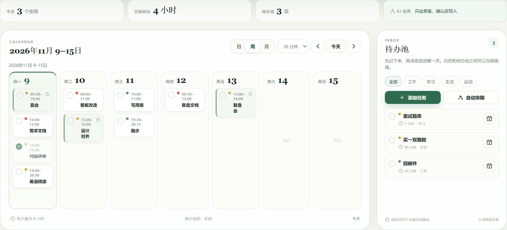
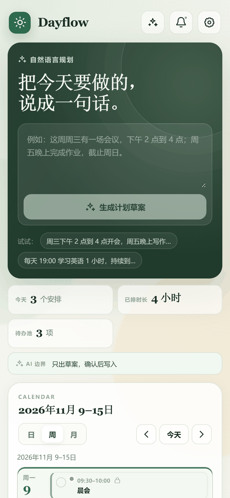

# Dayflow

[](https://github.com/waterfish111/Dayflow/actions/workflows/ci.yml)
[](LICENSE)
[](tsconfig.app.json)
[](public/manifest.webmanifest)

手机优先的个人日程助手。用一句自然语言描述安排，AI 只负责**理解语言**，具体时间由**确定性排期引擎**计算，确认后才写入日历。

> **核心取舍**：让模型做它擅长的事（把「周三下午组会改到四点」变成结构化字段），把「时间怎么排」交给可测试的代码。模型输出永远是草案，用户勾选后才落库。

在线演示：

- 阿里云服务器（IP 直连，国内可访问）：<http://39.106.48.233>
- Vercel（备用，部分大陆网络不可直连）：<https://dayflow-eta-teal.vercel.app>

> IP 直连版本走的是 HTTP，Service Worker 只在 HTTPS 下生效，所以「添加到桌面 / 离线缓存 / 浏览器通知」在这个地址上不可用；配好域名和证书后即可恢复。

| 自然语言 → 草案确认 | 周视图自动排期 | 手机端 390px |
|---|---|---|
|  |  |  |

## 它解决什么问题

日程工具的输入成本很高：想加一件事，要先选日期、再选时间段、再拖动、再确认冲突。但人描述计划时用的却是「明天下午写两小时报告，周五前交」这种模糊表达。

Dayflow 把这条路径压缩成一句话，同时不让 AI 直接决定时间——因为 LLM 不知道你今天 19:00 已经排了课，也不知道你每天最多安排 6 小时。

## 功能

- **自然语言 → 草案 → 确认**：一句话可以拆成多个条目（任务 / 固定事件）
- **人机边界**：信息不足时 AI 先反问；低置信度条目默认不勾选；明确说「加入待办池」则完全不排期
- **确定性排期**：按优先级、截止时间、首选时间、每日上限、任务间缓冲找空档；排不下就回待办池并说明原因
- **日历**：日 / 周 / 月三视图，15 / 30 / 60 分钟粒度，桌面端拖拽改期、拖回待办池
- **自定义节奏**：工作日 / 周末作息模板、每日安排上限、缓冲时间、免打扰时段、分类
- **PWA**：可安装、离线外壳缓存、应用内提醒与系统通知
- **数据自持**：状态存在浏览器 `localStorage`，DeepSeek Key 由使用者自带，支持 JSON 导出

## 排期引擎

`src/lib/scheduler.ts` 是一个纯函数：相同输入必得相同输出，不依赖随机数、不依赖网络。

```ts
autoSchedule(tasks, settings, { today: "2026-11-09" })
// → { tasks, warnings }
```

规则（按顺序）：

1. **候选日期**：任务已指定日期时只考虑那一天；有截止时间时从今天枚举到今天与截止日期的较小者；否则在 horizon 天（默认 14）内逐日尝试
2. **候选时段**：在作息模板的时间块内按粒度步进；没有时间块时回退到「起床–睡觉」整段
3. **冲突判定**：与已排条目重叠则跳过，前后各留 `bufferMinutes`
4. **每日上限**：只统计 `kind === "task"` 的时长，事件不占额度但占时间
5. **截止截断**：当天可用结束时间不超过截止时间
6. **失败处理**：所有候选日期都放不下时保持未排期，并返回「在接下来 N 天内没有找到合适的空档」的警告

举例：工作日可排 19:00–22:00，已占 19:00–20:30，新任务 60 分钟，缓冲 5 分钟 → 20:35 起找空档，按 30 分钟粒度落到 21:00–22:00。

## 技术栈

| 层 | 使用 |
|---|---|
| 前端 | React 19、TypeScript（strict）、Vite、原生 CSS |
| 本地服务 | Node.js、Express、Vite middleware |
| 线上 API | Vercel Serverless Functions |
| AI | DeepSeek Chat Completions，JSON 结构化输出 |
| 数据 | 浏览器 `localStorage`，local-first |
| 测试 | Vitest（37 个单元测试，覆盖排期与日期工具） |
| CI | GitHub Actions：typecheck → test → build |
| PWA | Manifest、Service Worker、通知权限 |

## 架构

```text
浏览器
  ├── React 页面（TypeScript / CSS）
  ├── 排期引擎（src/lib/scheduler.ts，纯函数）
  ├── 本地存储（src/data/storage.ts）
  └── POST /api/ai/parse
          ├── 本地：server/index.mjs
          └── 线上：api/ai/parse.js
                    └── server/ai.mjs
                          └── DeepSeek API
```

关键设计：

- **本地和线上共用 `server/ai.mjs`**，只有一套提示词和一套结果清洗逻辑，避免「本地能跑、线上不一样」
- **AI 输出要过两道清洗**：服务端校验 JSON 结构，客户端再用正则校验 `HH:mm` / `YYYY-MM-DD`，不信任模型输出
- **已排期状态是派生的**：`date && start && end` 三者齐全即为已排期，不额外存 `scheduled` 标志位，避免两个字段互相矛盾
- **日期用 `YYYY-MM-DD` 墙上时间**，不经过 UTC，避免跨时区偏移一天

## 快速开始

需要 Node.js ≥ 20 和 pnpm 11。

```bash
pnpm install
pnpm dev        # http://localhost:5173
```

常用命令：

```bash
pnpm typecheck  # tsc --noEmit，strict
pnpm test       # vitest run
pnpm build      # typecheck + vite build
pnpm preview    # 以生产模式启动本地服务
```

## 配置 DeepSeek

打开右上角「设置」，在 DeepSeek 区域填入自己的 API Key。

- Key 只保存在当前浏览器的 `localStorage`，不写入仓库、不经过数据库
- 请求由服务端代理转发，前端不把 Key 拼进页面代码
- 默认模型 `deepseek-chat`，可切换 `deepseek-reasoner`
- 部署方如果设置了环境变量 `DEEPSEEK_API_KEY`，未携带 Key 的请求会回退到它；公开部署时建议不要设置，否则等于对外开放额度

## 测试

```bash
pnpm test
```

`src/lib/scheduler.test.ts` 覆盖：空日历放置、时间块回退、跳过占用、缓冲边界、粒度取整、每日上限、截止截断、指定日期不跨天、优先级排序、`taskIds` 重排、事件不占额度、重复规则展开（每天 / 每周 / 每 N 天 / until / 缺字段）。

`src/lib/date.test.ts` 覆盖：跨月跨年加减、闰年、周起始、月视图 42 格、时间与分钟互转与夹取、免打扰跨零点。

CI 在每次 push 和 PR 上执行 `typecheck → test → build`。

## 已知限制

- **数据在单个浏览器**：换设备、换域名或清缓存不会自动迁移；目前只有导出，没有导入
- **通知不是真后台**：只在页面打开时每 30 秒检查一次，关闭页面后不会提醒；需要 Web Push 或 Capacitor 壳
- **`vercel.app` 在部分网络不可直连**：这是网络环境问题，不是代码错误；换自定义域名 + Cloudflare 或迁移机房可解
- **Key 明文存储**：`localStorage` 未加密，个人自用可接受，公开分享前需要改造
- **重复任务展开 42 天**：修改其中一次不会同步整组；`horizonDays` 参数当前包含起始日，展开条数比参数大 1
- **排期是贪心算法**：先排优先级高的任务，不做全局最优；已指定日期的任务排不下时不会自动跨天
- **暂无**：账号体系、云同步、子任务、统计报表、分享、系统日历同步、Android / iOS 原生包

## 项目文档

- [完整项目学习手册：从需求到部署](docs/PROJECT_LEARNING_MANUAL.md)
- [阶段一部署专题：Vercel 与 esbuild 问题](docs/PHASE1_LEARNING_MANUAL.md)
- [代码阅读笔记](docs/LEARNING.md)
- [Vercel 部署操作步骤](docs/DEPLOY_VERCEL.md)
- [云服务器部署（IP 直连，免备案）](docs/DEPLOY_VPS.md)
- [面试材料包：简历写法、90 秒讲述稿与预判问答](docs/INTERVIEW.md)

## 项目历程

| 时间 | 进展 |
|---|---|
| 2026-10-17 | 明确产品需求，完成第一版本地应用 |
| 2026-10-17 | 推送 GitHub 仓库，实现自然语言、排期、日历、待办池 |
| 2026-10-19 | 改造为 Vercel Serverless 结构并完成首次部署 |
| 2026-10-19 | 修复 pnpm / esbuild 安装脚本问题（`ERR_PNPM_IGNORED_BUILDS`） |
| 2026-10-19 | 完成线上健康检查；发现手机直连 `vercel.app` 受网络环境影响 |
| 2026-11-08 | 补充 MIT 协议、Vitest 单元测试与 GitHub Actions |
| 2026-11-09 | 补三张真实界面截图、仓库 About 与 `v0.2.0` Release |

## 下一步

1. 数据导入与 schema 版本迁移，让导出真正可用
2. 拆分 `src/App.tsx`（712 行）为 hooks + reducer，降低耦合
3. 服务端加限流与来源校验，避免公开部署时被刷额度
4. Web Push 或 Capacitor APK，补真正的后台提醒
5. AI 层补固定中文评测集，量化解析准确率

## License

[MIT](LICENSE)
